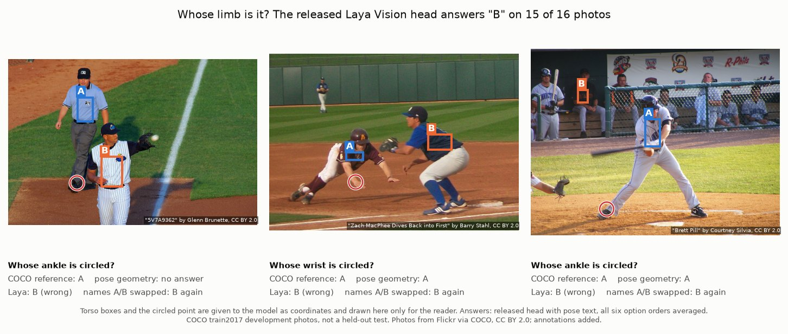

# Fast and slow vision: can a small, fast model describe people well enough to reason on?

Research code and experiments from Dhruva Chakravarthi's **Human State v0** study (September 2026). The idea, after
Kahneman's *Thinking, Fast and Slow*: let small, fast "System 1" models (classifiers, pose estimators, segmenters,
compact decision models) describe each person (posture, which limb belongs to whom, contact, movement, uncertainty),
and let slower vision-language models ("System 2") reason on top of that description. This repository tests the
fast half. The main candidate was **Laya Vision**, built on the 256M-parameter SmolVLM, which answers typed questions
in one forward pass. Laya Vision is third-party work, not Dhruva's (see [About Laya Vision](#about-laya-vision)).
Grappling is the hardest test case, but most experiments use general photos and video.

One folder per experiment: [`experiments/`](experiments/). Findings log: [`FINDINGS.md`](FINDINGS.md). Where each
number comes from: [`docs/SOURCES.md`](docs/SOURCES.md).

*Photos, left to right: "5V7A9362" by Glenn Brunette
([Flickr](https://www.flickr.com/photo.gne?id=9431997608)), "Zach MacPhee Dives Back into First" by Barry Stahl
([Flickr](https://www.flickr.com/photo.gne?id=5505334912)), "Brett Pill" by Courtney Silvia
([Flickr](https://www.flickr.com/photo.gne?id=7658431080)); all
[CC BY 2.0](https://creativecommons.org/licenses/by/2.0/), via COCO train2017. Boxes, circles and text added.*

Laya Vision picks "B" on 15 of 16 such photos. Swap the names A and B and it still says "B": it follows the letter,
not the person ([E02](experiments/E02-ownership-chain/)).

## Where it stands
The study's own conclusion: it built a working local pipeline and several informative negative results, a useful
limb-pair movement measure, and a DINOv2 posture readout that passed a small fresh audit. It **has not established
reliable general human-state understanding, contact or limb ownership, hidden-anatomy reconstruction or a learned
temporal improvement**. All labels are AI references (blind AI reviewers or published dataset annotations), not
human ground truth.

| Question (test set) | Laya-based result | Baseline or alternative |
|---|---|---|
| Posture, 36 held-out questions | trained decision heads 50.0%; probe on frozen features 66.7% | no-image class prior 36.1% ([E00](experiments/E00-pilot-typed-heads/)) |
| Same answer when the options are reordered | 42.4% (target 90%) | ([E01](experiments/E01-grounding-controls/)) |
| Answer follows the person when A and B swap names | 5.3% (target 80%) | ([E01](experiments/E01-grounding-controls/)) |
| Correct answers kept when the image is blanked | 36 of 41 | a grounded model should drop most ([E01](experiments/E01-grounding-controls/)) |
| Whose wrist or ankle? 172 COCO questions | visual heads 52.3% | learned geometry 72.7% ([E02](experiments/E02-ownership-chain/)) |
| Wrist/ankle within 5% of the image diagonal, 16 photos | best decoder on Laya grids 19.8% | YOLOX-M + RTMPose-M 98.3% ([E03](experiments/E03-spatial-readouts/)) |
| Movement of wrist/ankle pairs, 96 new clip pairs | (pose tool, no Laya) error 0.62% of diagonal | "no movement" 1.63% ([E05](experiments/E05-limb-pair-movement/)) |
| Filling in a hidden middle pose | trained adapter 0.24% of diagonal | linear interpolation 0.19% ([E06](experiments/E06-temporal-completion/)) |
| Posture on a fresh 3-family audit, macro recall | Laya-feature readout 0.24 | DINOv2 readout 0.79 ([E07](experiments/E07-fight-pilots/)) |
| Posture from frozen towers, same crops and head | Laya tower 70.9% | DINOv2 82.0%, Qwen3.8 tower 75.6% ([E08](experiments/E08-encoder-comparison/)) |

- **What held up:** frozen image features carry coarse posture information; an off-the-shelf pose tool plus
  hip-relative movement of limb *pairs* beats "no movement" on fresh clips; a frozen DINOv2 posture readout passed a
  fresh three-family audit.
- **What failed:** every trained Laya decision head, every visual ownership readout (geometry matched or beat all of
  them), every learned temporal model (interpolation won), and more correlated training data (it made a readout
  worse).
- **Speed, the point of System 1:** on a laptop CPU the full Laya model took a median 6.18 s per four-frame question
  (1.16 s reusing cached image features). Frozen towers on a laptop GPU: DINOv2-small 14.4 ms per crop, the Laya
  tower 23.4 ms, the Qwen3.8 tower 79.4 ms.
- **Not finished:** an ownership data-size study (32 / 96 / 288 photos) was prepared but never run; a larger
  fighting-label batch is partial (5 of 34 planned label requests saved, one invalid); no human review was done.

## About Laya Vision
- **Not Dhruva's model.** [Laya Vision](https://github.com/r33drichards/laya-vision) is an independent fork of
  [Laya](https://github.com/NandhaKishorM/laya) (Convai Innovations) that swaps Laya's text encoder for
  [SmolVLM-256M-Instruct](https://huggingface.co/HuggingFaceTB/SmolVLM-256M-Instruct) and keeps Laya's typed questions
  (`choice` / `score` / `noul`) and calibration. Code: Apache-2.0. Weights:
  [thaitea/laya-vision-smolvlm-256m](https://huggingface.co/thaitea/laya-vision-smolvlm-256m), marked
  non-commercial on their model card. Neither is redistributed here.
- Pinned in this study: code `86ccec115ef3d72d1851168fc9b7194e8dbed35a`, weights
  `a2653db2831b9b03b875a6558618feda833b7ff0`.
- Its vision tower is value-for-value identical to public SmolVLM-256M-Instruct; its connector and language model
  differ ([E04](experiments/E04-component-audit/)).
- These experiments ask it questions it was not trained for (people, limbs, motion). They say nothing about its
  reported results on its own benchmarks.

## Layout
- `src/`: the code (flat modules; each states its environment and usage in its docstring). Data, model and output
  locations: `src/fsv_paths.py` (environment variables `FSV_DATA`, `FSV_MODELS`, `FSV_OUT`).
  - `laya_query.py`: ask Laya Vision a typed ownership question, with option-order, renaming and blank-image controls.
  - `controls.py`: control metrics and logit averaging over option orders and names.
  - `ownership_questions.py`: COCO limb-ownership questions and the geometry baselines.
  - `encoder_features.py`, `posture_probe.py`, `spatial_decoder.py`: the matched DINOv2 / Laya / Qwen comparison.
  - `limb_pair_movement.py`: hip-relative limb-pair movement and the selective-answer policy.
  - `temporal_completion.py`: the 68,280-parameter temporal adapter and its training loop.
  - `component_audit.py`: tensor-by-tensor checkpoint comparison.
  - `make_charts.py`, `make_demo_figure.py`: every figure in `docs/assets/`.
- `experiments/E<nn>-<name>/README.md`: one page per experiment.
- `tests/`: synthetic checks of `src/` (`python3 -m unittest discover -s tests`).
- `env/`: pinned package lists (Python 3.11 CPU runtime; charts).

## Data and models (not redistributed here)
- **COCO** train2017 / val2017 person keypoints (annotations CC BY 4.0; images under their Flickr licences, only
  CC BY 2.0 and CC BY-SA 2.0 photos were used).
- **Penn Action** (Zhang et al., ICCV 2013) and **UT-Interaction** (Ryoo and Aggarwal): research datasets, used
  for joint coordinates and action codes.
- **Wikimedia Commons** videos (CC BY, CC BY-SA, CC0 and US-government public domain; each file's licence was
  recorded) and **DVIDS** public-domain combatives footage, for the fighting pilots.
- **Bus Violence** (Zenodo record 7044203; attribution, non-commercial), simulated bus-camera clips.
- Jiu-jitsu frames from instructional and match footage whose redistribution terms are unclear (pilot and spatial
  comparison only).
- **Models:** Laya Vision (above); SmolVLM-256M-Instruct (Apache-2.0); DINOv2-small (Apache-2.0); the vision tower of
  Qwen3.8-27B (open weights; only the tower was run); YOLOX-M and RTMPose-M (via rtmlib).
- **Labels:** the posture, contact and fighting labels are answers from a frontier AI model run as a blind reviewer,
  checked by repeat runs and independent audits. They are AI references, not human ground truth. Metered (paid)
  labelling was recorded only for the fighting pilots: about $13.11 over 74 calls (conservative ledger total).

## What it led to
- The failures all point at one gap: binding what the model sees to the right person, limb and moment. Features
  carry information; small readouts on top did not attach it to the right actor.
- The next design keeps the evidence behind each label (identity-aware boxes, masks, local actor identity,
  uncertainty) instead of coarser state labels, and uses specialist perception tools as System 1.
- Later work measures two-person relations geometrically, from 3D bodies, instead of asking a VLM:
  [engage3D](https://github.com/dhruvinci/engage3d).

## Licence
Code: MIT ([`LICENSE`](LICENSE)). Documents, figures and results: CC BY 4.0. The three photos in
`docs/assets/demo_ownership.jpg` remain CC BY 2.0 by their authors (credited above). Third-party data and models keep
their own licences.

## Citation
See [`CITATION.cff`](CITATION.cff).
