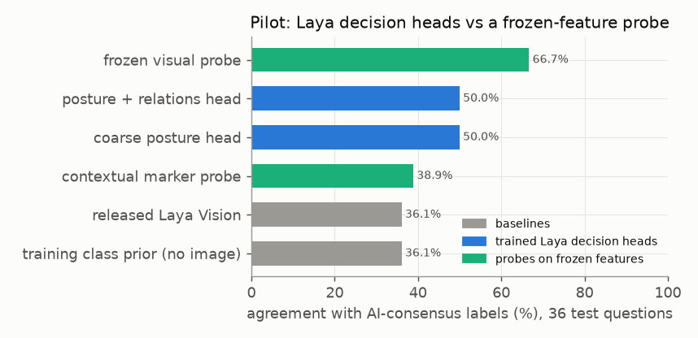

# E00 — Pilot: typed decision heads on Laya Vision

**Objective.** Laya Vision answers typed questions in one forward pass. Fine-tuned with extra relational supervision
(contact, ownership, geometry, motion), does its decision head answer posture questions about people better? Does a
plain probe on its frozen image features do as well?

**Setup.**
- 528 questions over 95 windows (263 images, 29 source groups) of jiu-jitsu frames and UT-Interaction clips: posture,
  contact, limb ownership, torso angle, motion. References: the 454 questions two blind AI-reviewer runs agreed on.
  Test: 92 questions from 5 groups, 36 of them posture. Splits and budgets frozen before fitting.
- Backbone frozen. Coarse posture head; posture + relations head (same start, extra auxiliary updates); a probe on
  frozen visual features (standardised after a documented amendment, before test was opened); a marker probe.

**Results** (36 test posture questions, agreement with the AI consensus)
| condition | agreement | macro-F1 |
|---|---|---|
| no-image class prior | 36.1% | 0.117 |
| released Laya Vision | 36.1% | 0.239 |
| coarse posture head / posture + relations head | 50.0% / 50.0% | 0.316 / 0.320 |
| **frozen visual probe** | **66.7%** | 0.326 |
- Relations vs coarse head: +0.0045 macro-F1 against a pre-registered +0.05; both get the same 18 of 36 right.
- Thresholds set for 10% error on calibration footage gave 29.4% and 33.3% error on test. Non-grappling posture
  (91.7%) equals the no-image prior; no learned condition predicted seated or reclined on this test slice.
- Four frames of frozen features + ridge classify 120 UT-Interaction clips at 80.0% across held-out recording groups.

**Verdict.** **Fail** on the pre-registered contrast: relational supervision added nothing.
**Learned.** The frozen features carry coarse posture and action information; the decision head is the weak link.
**Next.** Check whether answers depend on the right person, option and image ([E01](../E01-grounding-controls/)).

Source reports (research archive): `research/RESULTS.md`. Line references: [docs/SOURCES.md](../../docs/SOURCES.md).
