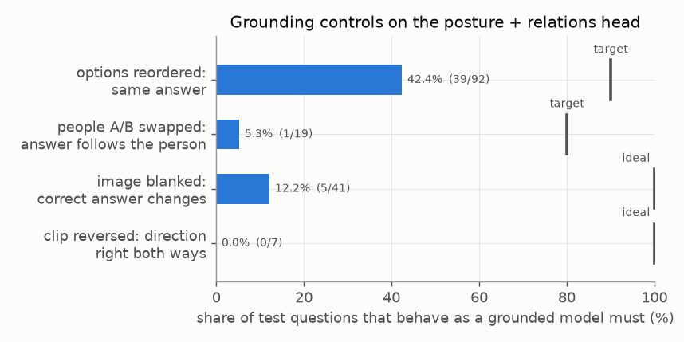

# E01 — Grounding controls: does the answer depend on the right evidence?

**Objective.** A useful answer about a person should follow that person, the option's meaning (not its position),
the pixels and the order of frames. Do Laya Vision's answers?

**Setup.**
- 468 control queries per condition on the E00 test split: options reordered, actors A/B swapped, paraphrases,
  blank and shuffled images, region masking, time reversal, one vs four frames.
- Changed pixels get sensitivity measures only; no correct answer is invented for an altered image.
- Later, the same checks on video: 48 released-model decisions and 768 whole-clip posture decisions.

**Results** (posture + relations head)
| control | result | target |
|---|---|---|
| options reordered: same answer | 39/92 (42.4%) | 90% |
| A/B swapped: answer follows the person | 1/19 (5.3%) | 80% |
| blank image: top answer unchanged | 72/92, including 36 of 41 correct ones | should change |
| shuffled image from another source: unchanged | 39/46 | should change |
| reversed clip: direction right both ways | 0/7 | 7/7 |
| four frames vs the last frame alone | same top answer on 8/8 | four should help |
- A tokeniser audit (92 pairs, 848 option markers) found no option-mapping bug. Averaging two option orders: 41/92 →
  45/92 overall; posture stays at 18/36.
- Video: 6 of 8 question/view combinations changed winner when only the option order changed; target and partner
  regions gave the same mean winner on 31 of 32 actor slots; blank input never chose "unknown".

**Verdict.** **Fail** on every control.
**Learned.** Answers depend on option position and the letters A/B more than on the image. Consistency alone can pass
vacuously (a no-image prior is perfectly consistent under time reversal), so score joint correctness instead.
**Next.** Isolate person–limb binding with published ownership labels ([E02](../E02-ownership-chain/)).

Code: `src/controls.py`, `src/laya_query.py`. Source reports (research archive): `research/RESULTS.md`,
`research/OPTION_ORDER_DIAGNOSTIC.md`, `video_demo/laya_conditioning/RESULTS.md`,
`video_demo/posture_checkpoints/RESULTS.md`. Line references: [docs/SOURCES.md](../../docs/SOURCES.md).
