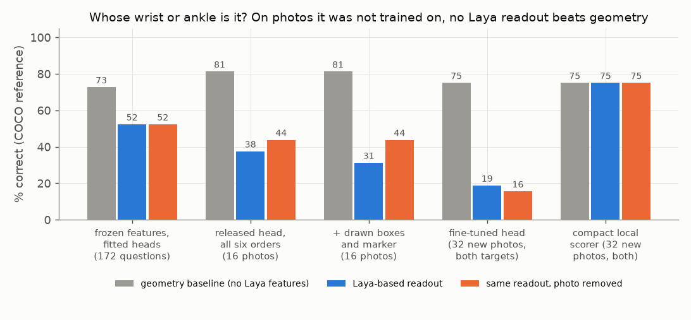

# E02 — Ownership chain: whose wrist or ankle is it?

**Objective.** Can any Laya-based readout tell which of two people a visible wrist or ankle belongs to, better than
geometry alone?

**Setup.** COCO person keypoints become "whose limb?" questions: two torso boxes (A, B) and one visible wrist or ankle,
CC BY / CC BY-SA photos only; the reference is COCO's annotation. Seven steps, each fixed before it ran, from frozen
features with fitted heads, through the released model zero-shot (with pose-tool points as text), to fine-tuning the
8.31M-parameter decision readout and a compact local scorer. Geometry: learned distances (step 1), nearest pose-tool
point (2–5), nearest torso box (6–7).

**Results**
| step | Laya-based | geometry | same readout, photo removed |
|---|---|---|---|
| 1. frozen features + fitted heads, 172 questions | 90 (52.3%) | 125 (72.7%) | unchanged (heads never left zero) |
| 2. released head, 16 development photos | 5/16 | 13/16 (+3 unknown) | 7/16 |
| 3. + all six option orders | 6/16; "B" wins 85 of 96 orderings | 13/16 | 7/16 ("B" every time) |
| 4. + boxes and target drawn in the image | 5/16 | 13/16 | 7/16 |
| 5. readout fine-tuned on these 16 | 14/16 (training photos) | 13/16 | 8/16 |
| 6. fine-tuned on 32 photos, tested on 32 new, both targets | 6/32 (train 30/32) | 24/32 | 5/32 |
| 7. compact local scorer, same 32 new photos | 24/32 | 24/32 | 24/32 (all 64 decisions identical) |
- Renaming A/B, answers mapped back consistently on 0/16 (step 3), 5/16 (step 4) and 12/16 (step 5).
- A blind AI model shown full-scene and highlighted panels got 40/40 on a 40-question subset of step 1 (exact 95%
  interval 91.2–100%); geometry got 27/40 of the same.

**Verdict.** **Fail** at every step. On photos it was not trained on, no Laya-based readout beat geometry; the one
that matched it ignored the photo.
**Learned.** The released head prefers the letter "B" whatever the option order. Fine-tuning memorises and does not
transfer. The gap is binding features to the right person, not missing features.
**Next.** A training-size curve (32 / 96 / 288 photos) was prepared but never run. Localise joints directly:
[E03](../E03-spatial-readouts/).

Code: `src/ownership_questions.py`, `src/laya_query.py`, `src/controls.py`. Source reports (research archive):
`ownership_{reference,repair,order,markers,supervised,pairs,locality}/RESULTS.md`. Line references:
[docs/SOURCES.md](../../docs/SOURCES.md).
