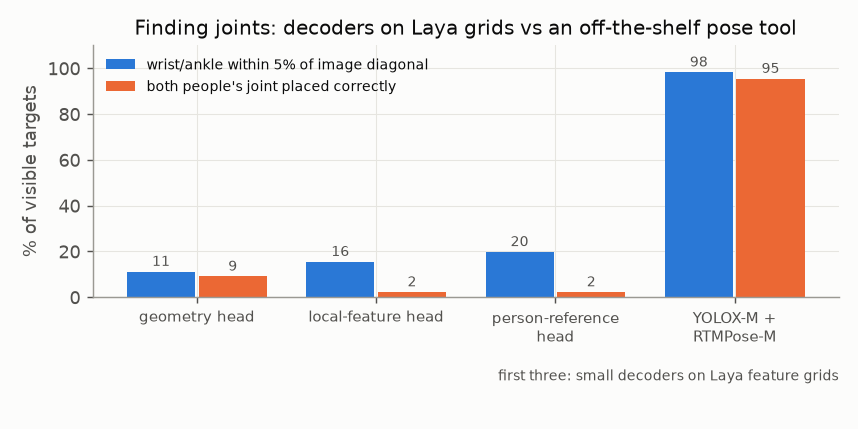

# E03 — Spatial readouts: can small decoders on Laya's feature grids find each person's joints?

**Objective.** If the decision head cannot bind a limb to a person, can a small spatial decoder on Laya's cached
feature grids locate a given person's wrists and ankles?

**Setup.**
- COCO development photos: 346 training photos (2,315 visible wrists/ankles) and 86 validation photos (598). Each
  query supplies the image and the person's torso box; the target joints are never in the input.
- Three affine heatmap heads on the cached grids: geometry only (36 parameters), + local features (2,340), + a
  person-reference interaction from the torso crop (6,948). Fixed 600 Adam updates; no encoder or language forwards.
- Follow-ups: decode the peak cell instead of the heatmap mean; run a pretrained tool (YOLOX-M detector + RTMPose-M)
  on 16 of the validation photos and compare on the same people.

**Results** (within 5% of the image diagonal; "both people" = a pair of same-named joints, both placed correctly)
| method | visible wrists/ankles | both people |
|---|---|---|
| geometry head | 17.6% (105/598) | 4.0% (8/200) |
| local-feature head | 19.1% (114/598) | 2.0% (4/200) |
| person-reference head | 19.7% (118/598) | 2.0% (4/200) |
| person-reference head, peak-cell decoding | 23.2% (139/598) | 4.0% (8/200) |
| 16 photos: person-reference head | 19.8% (23/116) | 2.3% (1/44) |
| 16 photos: YOLOX-M + RTMPose-M | **98.3% (114/116)** | **95.5% (42/44)** |
- Person reference vs local features: +0.67 points, interval −1.97 to +3.11. The reference changes the output
  without binding it to the person (both-person identity 32.0%, below geometry's 39.5%).
- Peak decoding gains hits but worsens mean error and identity (32.0% → 26.5%).
- All 16 photos are COCO train2017 and RTMPose's training data include COCO: an implementation baseline, not a
  generalisation result.

**Verdict.** **Fail** for decoders on Laya grids; the pretrained pose tool works on these photos.
**Learned.** Finding a joint and finding *whose* joint it is are separate problems; decoding tricks trade one for the
other.
**Next.** Use the pose tool for movement ([E05](../E05-limb-pair-movement/)); check what Laya changed in its towers
([E04](../E04-component-audit/)).

Source reports (research archive): `person_grounding/RESULTS.md`, `heatmap_diagnostics/RESULTS.md`,
`pose_reference_pilot/RESULTS.md`. Line references: [docs/SOURCES.md](../../docs/SOURCES.md).
