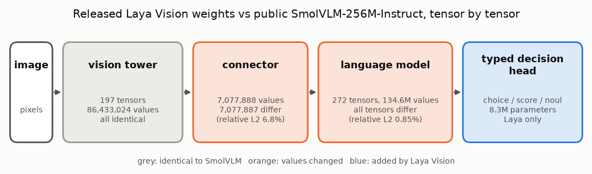

# E04 — Component audit: which parts of Laya Vision are actually Laya's?

**Objective.** Laya Vision is built on SmolVLM-256M-Instruct. Before crediting (or blaming) Laya for anything seen in
its image features, check which weights it changed.

**Setup.**
- Tensor-by-tensor comparison of the released checkpoint (`a2653db…`) with public SmolVLM-256M-Instruct (`7e3e67e…`).
  BF16 values are widened to FP32 exactly; equality has no tolerance. No model is built or run.
- Matched connector comparison: the same cached 32×32 vision-tower grids, passed through each checkpoint's connector,
  then the same 13-joint decoder (7,501 parameters, 300 updates) on 384 training / 96 validation Penn Action pairs.

**Results**
| component | tensors | values | values that differ |
|---|---|---|---|
| vision tower | 197 | 86,433,024 | **0** |
| connector | 1 | 7,077,888 | 7,077,887 (relative L2 difference 6.8%) |
| language model (added 2026-10-26) | 272 | 134,588,736 | 134,588,392 (relative L2 difference 0.85%) |
- The language-model row was added while preparing this repository, with `src/component_audit.py`; the same script
  reproduced the two original rows exactly.
- Connector comparison, joints within 5% of the image diagonal: Laya 43.39% (925/2,132) vs SmolVLM 42.59% (908/2,132),
  +0.80 points (interval 0 to +1.57). Movement accuracy 43.7% vs 42.8%.

**Verdict.** The vision tower is SmolVLM's, unchanged. Results on vision-tower features (for example the "Laya tower"
in [E08](../E08-encoder-comparison/)) describe SmolVLM. Laya's own changes (connector, language model, decision head)
made little difference to joint localisation.
**Learned.** Audit what a third-party model actually changed before attributing results to it. Matching values do not
prove which revision it was trained from.
**Next.** Compare towers directly, under identical inputs ([E08](../E08-encoder-comparison/)).

Code: `src/component_audit.py`. Source reports (research archive):
`temporal_reference/parent_identity/IDENTITY_AUDIT.md`, `connector_comparison/RESULTS.md`. Line references:
[docs/SOURCES.md](../../docs/SOURCES.md).
