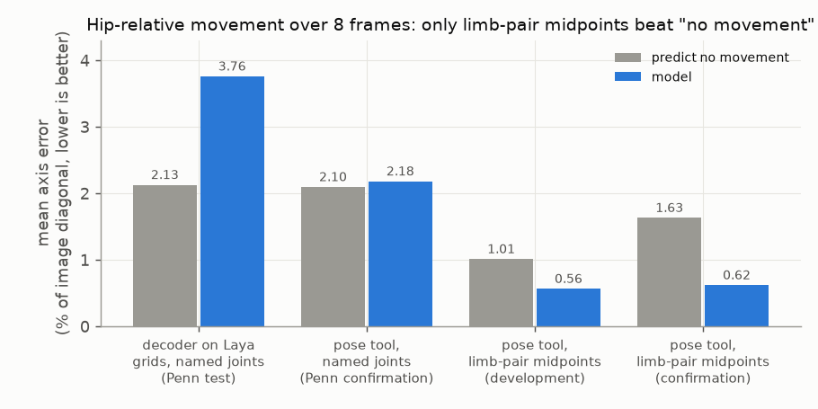

# E05 — Movement: hip-relative wrists and ankles, and the limb-pair midpoint

**Objective.** Measure movement simply: over eight frames, how does each wrist and ankle move relative to the hips?
Answer per axis: decreased, little change or increased (±2% of the image diagonal).

**Setup.** Penn Action (published joint coordinates, one annotated person per clip). Four steps:
1. joints decoded from Laya feature grids, 192 test pairs, against direct classifiers on the images;
2. a pretrained pose tool (YOLOX-M + RTMPose-M) tracking one person from a given first torso box, 128 fresh pairs;
3. the same poses, with left and right averaged into a limb-pair midpoint (16 development pairs);
4. that midpoint measure on 96 fresh pairs, with a confidence policy (≥ 50% coverage, ≤ 15% error) frozen on 64
   calibration pairs first.

**Results** (mean axis error, % of image diagonal, method vs "no movement" on the same answers)
| step | error | decisions |
|---|---|---|
| 1. Laya-grid decoder, named joints | 3.76 vs 2.13 | +11.7 points balanced accuracy over a direct classifier that never left its start; no confidence policy qualified |
| 2. pose tool, named joints | 2.18 vs 2.10 | balanced accuracy 55.5%; 23.9% error at 66% coverage |
| 3. pose tool, limb pairs, development | 0.56 vs 1.01 | 37/40 axis classes |
| 4. pose tool, limb pairs, fresh | **0.62 vs 1.63** (−62%) | **258/262 accepted, 8.5% error** |
- Limits of step 4: only 131 of 192 limb-pair slots had valid references; 202 of 262 answers were "little change";
  on the 58 accepted directional answers, 9 were wrong (15.5%). Image-plane displacement, not speed or 3D.
- Left/right is the snag: for 43% of step-1 predictions the opposite-side joint was closer than the intended one,
  and an audit of side naming settled only 4 of 64 audited coordinate slots.

**Verdict.** Named joints **fail**. Limb-pair midpoints **pass** all four pre-set criteria on fresh pairs. This is a
pose-tool result; no Laya component is involved in steps 2–4.
**Learned.** Averaging left and right removes the unresolved side identity and leaves a usable movement signal, at
the price of cancelling opposite limb movements. Always score against "no movement" on the same answers.
**Next.** Fill gaps over time ([E06](../E06-temporal-completion/)).

Code: `src/limb_pair_movement.py`. Source reports (research archive): `temporal_reference/RESULTS.md`,
`pose_transfer/RESULTS.md`, `side_semantics_audit/RESULTS.md`, `centroid_diagnostics/RESULTS.md`,
`centroid_transfer/RESULTS.md`. Line references: [docs/SOURCES.md](../../docs/SOURCES.md).
