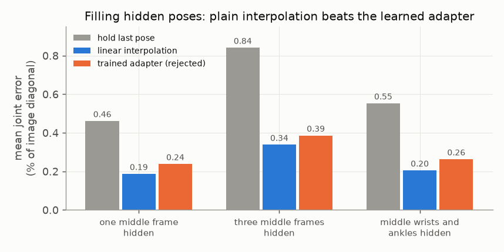

# E06 — Temporal completion: learned adapter vs interpolation

**Objective.** When a pose is missing for a frame or two (occlusion, a failed detection), can a small learned temporal
model fill it in better than interpolating between the neighbouring frames?

**Setup.**
- A temporal convolution over nine poses (12 joints + availability flags, 68,280 parameters) that learns a residual
  over linear interpolation. Its output starts at zero, so "step 0" *is* interpolation. Poses only: no RGB, no Laya.
- Penn Action annotations with synthetic hiding: one middle frame, three middle frames, or the middle wrists and
  ankles. 3,072 training windows (384 source groups), 96 validation, 192 test. These groups had been used before, so
  this is development evidence.
- Two fixed runs of 800 updates: with observation noise, and a follow-up without it. Validation every 100 steps;
  earliest minimum wins, step 0 included.

**Results** (mean error on the same returned joints, % of image diagonal)
| hidden | hold last pose | interpolation | trained adapter |
|---|---|---|---|
| one middle frame | 0.461 | **0.187** | 0.238 |
| three middle frames | 0.841 | **0.338** | 0.386 |
| middle wrists and ankles | 0.553 | **0.205** | 0.263 |
- Both runs selected step 0, i.e. interpolation. On validation, the first run's best trained checkpoint was 1.5% worse
  and the noise-free run's final checkpoint 4.7% worse. The trained candidate is shown only as a rejected diagnostic.
- Demo: 133 samples over seven clips (Penn Action plus three activity clips). Natural missing joints have no hidden
  truth, so they are shown, not scored.

**Verdict.** **Fail**: no learned improvement over interpolation.
**Learned.** For short gaps with good observations interpolation is hard to beat. A pose-only model cannot repair a
confidently wrong, wrong-person observation, and smooth output is not evidence of correct anatomy.
**Next.** Feed per-actor visual tokens, masks and time gaps, and allow "unknown" (proposed, not run). The same pattern
recurs in the fighting pilots ([E07](../E07-fight-pilots/)).

Code: `src/temporal_completion.py`. Source reports (research archive): `temporal_completion/RESULTS.md`,
`temporal_completion/FOLLOWUP_CLEAN.md`. Line references: [docs/SOURCES.md](../../docs/SOURCES.md).
