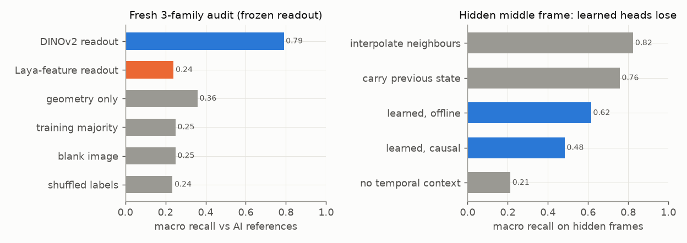

# E07 — Fighting pilots: actor posture on new sources, and the DINOv2 readout that passed a fresh audit

**Objective.** On fighting and exercise video from sources never seen in training, can frozen image features plus a
small readout label each person's posture (upright, crouched/kneeling, seated/reclined, lying)? Does temporal context
help?

**Setup.**
- Public video with recorded licences: Wikimedia Commons (CC BY, CC BY-SA, CC0, US-government public domain), DVIDS
  public-domain combatives, and simulated Bus Violence clips. Videos grouped into source families; whole families held
  out. Actor boxes are assisted (given), not detected.
- Labels from a blind AI reviewer, with blind repeats and independent audits: AI references, not human truth.
- Pilot 1: Laya image features + ridge readout. Pilot 2: DINOv2-small features, more independent families, causal and
  offline temporal heads, then a fresh audit on three unseen families (wrestling, an army drill, an outdoor gym).

**Results**
| stage | result |
|---|---|
| pilot 1, bus development (26) | Laya-feature readout 17/26; majority 11/26 |
| pilot 1, refit with 82 more crops (mostly upright) | 11/26, all upright, equal to the blank-image control: rejected |
| pilot 1, three independent audits (52 targets) | macro recall 0.326 vs majority 0.333: **fail** |
| pilot 2, family holdout (184 rows) | DINOv2 0.737 vs Laya 0.582; on the bus cohort Laya 0.797 vs 0.597 |
| pilot 2, hidden middle frame (84 targets) | interpolation 0.825; carry forward 0.758; learned offline 0.615, causal 0.484 |
| pilot 2, fresh audit (47 known) | **DINOv2 36/47, macro recall 0.789**; Laya 0.241; geometry 0.360; shuffled labels 0.235 |
- Wrestling stayed weak (0.40, tied with geometry). Swapping in the partner's crop cut macro recall 0.40 → 0.10 on 19
  co-visible targets: the readout looks at the target region, but identity is still given, not found.
- Gate: blind repeats agreed on 52/58 labels and 64/66 actor attributions; the readout then ran on an uploaded video.
  The full stage stopped early (5 of 34 planned label requests saved, one invalid; no full temporal model).
  Paid AI labelling for the whole branch: about $13.11 over 74 calls (conservative ledger total, not an invoice).

**Verdict.** Pilot 1 **fail**. Pilot 2 spatial **pass**, with DINOv2, not Laya. Learned temporal heads **fail**.
**Learned.** Coverage across independent families mattered more than row count: more correlated upright data broke
the bus readout. No universal encoder winner (Laya won on the bus cohort). Stable states inflate hidden-frame scores:
interpolation matched 75/84 overall but only 5/9 next to a posture change.
**Next.** Compare encoders under identical inputs ([E08](../E08-encoder-comparison/)).

Code: `src/encoder_features.py`, `src/posture_probe.py`. Source reports (research archive): `fight_experiment/`
(`PILOT1_ASSESSMENT.md`, `pilot2-*/RESULTS.md`, `pilot2-gate/assessment.json`, `SOURCE_CATALOG.md`). Line references:
[docs/SOURCES.md](../../docs/SOURCES.md).
