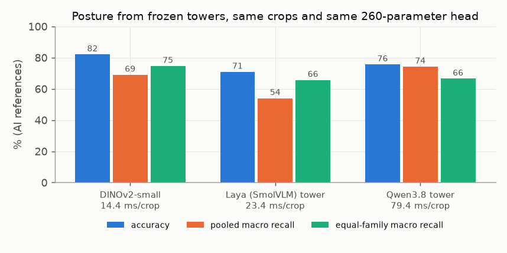

# E08 — Encoder comparison: DINOv2 vs Laya (SmolVLM) vs Qwen3.8 towers

**Objective.** With everything else held equal, which frozen vision tower carries more posture and ownership
information: DINOv2-small, Laya's tower (identical to SmolVLM's, [E04](../E04-component-audit/)) or the vision tower
of Qwen3.8-27B?

**Setup.**
- Posture: 245 identical 448×448 actor crops from 15 videos. Final patch tokens, mean-pooled, standardised and reduced
  to 64 dimensions on training rows only, then the same 260-parameter source-balanced ridge head. Scored on 172 known
  AI references from seven hard source families. Only the towers ran (no language model).
- Ownership: a per-cell decoder (A1 / A2 / background, 24,738 parameters for every representation) was also compared,
  but only on four clips of private product footage, so those results are withheld here.

**Results**
| posture (172 references) | accuracy | pooled macro recall | equal-family macro recall | ms per crop |
|---|---|---|---|---|
| DINOv2-small | **82.0%** | 69.0% | **74.6%** | **14.4** |
| Laya / SmolVLM tower | 70.9% | 54.0% | 65.7% | 23.4 |
| Qwen3.8 tower | 75.6% | **74.2%** | 66.5% | 79.4 |

- Qwen found 15/18 seated and 20/30 crouched (DINOv2 6/18, 15/30); DINOv2 found 99/102 upright and 21/22 lying.

**Verdict.** No universal winner. DINOv2 is the fast, consistent default; Qwen adds minority-posture signal; Laya's
tower trails on posture.
**Learned.** Encoder choice depends on the posture class: no single tower wins across seated, crouched, upright and
lying.
**Next.** Pixel ownership on public data with exact labels (planned as the engage3D geometry-probe benchmark).

Code: `src/encoder_features.py`, `src/posture_probe.py`, `src/spatial_decoder.py`. Source reports (research archive):
`encoder_comparison/RESULTS.md`. Line references:
[docs/SOURCES.md](../../docs/SOURCES.md).
